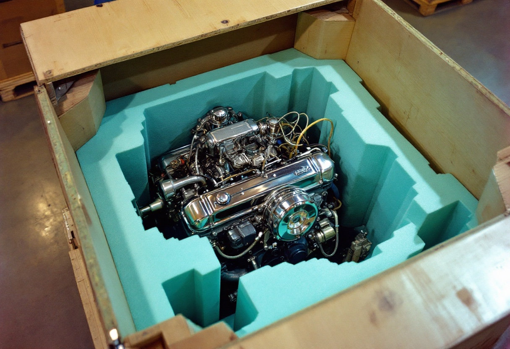
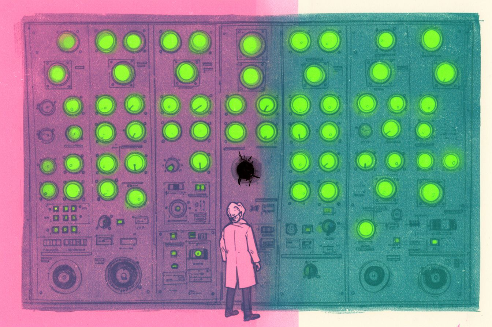

+++
title = "Nobody Told the Packagers"
date = 2026-06-22
description = "Ollama 0.30 moved inference into a new binary and forgot to tell the packagers. The missing sentence never shipped."
summary = "Ollama 0.30 moved GGUF inference into a separate llama-server binary, and half the ecosystem's packages shipped without it. The server started, the health checks passed, MLX models ran fine — and every GGUF model failed. A story about the bug that was really a missing sentence — and the clearer error that never shipped either."
images = ["/og/nobody-told-the-packagers.png"]
+++

On June 2nd I wrote myself a note that reads, in retrospect, like a man nailing a sign
to his own front door: **don't `brew upgrade ollama`.**

The new 0.30 release had moved all GGUF inference out of the main binary and into a
separate runner called `llama-server`. The official tarball bundled it. The Homebrew
formula did not. Neither did Arch, or conda-forge, or a half-dozen Docker images that
copied the `ollama` binary over and called it a day. Everyone who upgraded through a
package manager got a server that started cleanly, answered `/api/tags`, ran MLX models
without complaint — and failed every single GGUF model with `llama-server binary not
found`. Tracking: [ollama/ollama#16417](https://github.com/ollama/ollama/issues/16417),
plus the [Homebrew twin](https://github.com/homebrew/homebrew-core/issues/285917).
I stayed on 0.23.0, where the old in-process path still worked, and waited out the
wreckage. My [talkie fork](/practice/talkie-on-apple-silicon/) was already living on a
custom 0.30.x build, so I got to watch the split from both sides of the glass.

<!--more-->

And to be fair to both sides, as I wrote in that thread: this was never really an
Ollama bug in the broken-code sense, and it wasn't a brew bug either. It was a
packaging gap. The formula's `go build` produces the Go binary and the MLX runner;
Ollama builds `llama-server` separately via the CMake project in `llama/server/`,
so it never landed in `libexec/lib/ollama/`. The official installer shipped it, and
a plain `go build` didn't — which is why the same version was simultaneously fixed
and broken depending on how you installed it.

Here's the rub: nothing about this failure looked like a
failure. The daemon was up. The tags endpoint answered, so every health check in the
world reported green. If your models were [MLX](/glossary/mlx/), nothing was wrong at all — the new
binary was only needed for [GGUF](/glossary/gguf/). So the symptom presented as:
_everything works except the thing you actually wanted_, and the error named a binary
most users had never heard of, in a sentence that read like build instructions
(`Run 'cmake … build …' first`). Half-broken is harder to diagnose than fully broken.
Fully broken gets you a stack trace and a search query. Half-broken gets you an
afternoon of doubting your own models.

My first instinct was the engineer's instinct: paper over it. I wrote a PR that fell
back to a `llama-server` found on `$PATH` — llama.cpp ships one, half the affected
machines already had it sitting right there. It died in review, correctly. Per the
maintainer, Ollama's `llama-server` is patched for model compatibility and
version-locked to the exact GGML build, so a stray binary from another build isn't a
fallback. It's a _different engine wearing the same name_, and silently swapping it in
would trade a loud failure for quiet wrongness. A wrong answer delivered confidently
is worse than no answer at all. I have [written about that shape before](/blog/the-cognitohazard-was-the-smile/)
in a different costume.

So the PR got slimmed down to the only thing that might survive review: a clearer
not-found error ([ollama/ollama#16432](https://github.com/ollama/ollama/pull/16432)).
No fallback, no machinery. Just a sentence. It never merged — closed, unshipped.
The cheapest fix available, words, died in the queue, and every package-manager user
kept getting the cryptic one that read like build instructions.

That is the whole post, really. I went back and read the 0.30.0 release notes:
"improved compatibility and performance using llama.cpp," "support for a wider range
of models, including GGUF-based models." A real improvement, stated plainly. Now look
for the line that says downstream packagers must bundle a new `llama-server`
component or the runtime fails hard without it. That line isn't there. If it had
been, we'd have been spared half a dozen threads and a lot of people downgrading to
0.24.0. (The eventual Homebrew fix,
[#285963](https://github.com/Homebrew/homebrew-core/pull/285963), builds the server
from the Ollama tree with the right preset — Metal on Apple Silicon. The code
decisions were sound. Only the announcement was missing.)

Upstream renamed where the engine lives. The downstream packagers — the people who
actually convey the software to its users, who read neither repo's commit log over
morning coffee — were never told in a form they could act on. The interface between two projects isn't the function signature. It's
the changelog entry written for the stranger. Every dependency you take is a
communication channel you're now responsible for, and this one went quiet at exactly
the moment it moved.

De-evolution usually arrives wearing progress. A cleaner architecture — inference
out-of-process, one runner binary, proper separation — and the cost of the renovation
was a sentence nobody wrote. The build broke where the docs weren't, and the fix never shipped as code or as a
sentence either. Say what you moved, where it
went, and who has to carry it. That is the entire discipline, and it fits in a
changelog line. No fingers pointed — just a slightly ironic lesson to take from a
project whose entire job is to model human communication.
