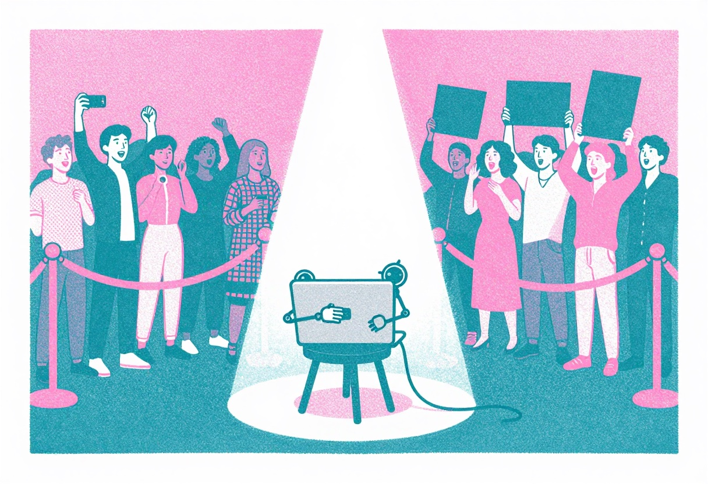

+++
title = "Switched-Off Bach"
date = 2026-10-02
description = "I'm a developer and a musician. One room loves AI, the other hates it. I ported Meta's music generator to my Mac anyway."
images = ["/og/switched-off-bach.png"]
aliases = ["/deep-dives/audiocraft-apple-silicon/"]
summary = "I'm a software developer and a musician, and those two rooms have opposite opinions about AI. A walk from the 1982 attempt to ban the synthesizer to Meta's music generator running on my Mac, where the worst bug was caught by ear before any test noticed."
tags = ["apple-silicon", "music-generation", "mps", "transformer"]
semantic_id = "v2:t-kOUKApT4XQwZrvyVA9JbrLngZ5bn7O"
related_by_meaning = ["/practice/talkie-on-apple-silicon/", "/deep-dives/porting-ml-to-apple-silicon/", "/glossary/metal/", "/deep-dives/ctranslate2-metal-backend/03-msl-indignities/"]
+++

I belong to two clubs that do not get along.

In one I'm a software developer. Over there, AI is the best thing to happen to the job since Stack Overflow,
maybe since the compiler. "Claude/Codex did it" is standard operating procedure. Every project
on this site is AI-coded; tell developers and the follow-up question is which model.

In the other club, I'm a musician. My band, [OWNER/OPERATORS](https://owneroperators.online/),
makes songs most people will never hear. Say the same thing to musicians and the temperature
drops. "AI" is less a technology than an accusation, something you say _about_ a song the way
you'd say a performance was lip-synced.

Same technology. Same year. Same guy, opposite verdicts. I ported Meta's music generator,
[AudioCraft](https://github.com/oo-eric/audiocraft), to a MacBook: the crime of one club using
the power tools of the other.

<!--more-->

## Why the two rooms disagree

Neither room is stupid or wrong. They're looking at different machines that share a name.



**Code is judged by what it does. Music is judged by who did it.** Nobody listens to a
function. Developers have always run other people's code: libraries, open source, the Stack
Overflow answer pasted in at 2am with the variable names still wrong. Authorship is a
`git blame` line you check to find out who to yell at. A song is different. The same notes from
someone else make a cover. Take the "who" out of code and it still runs. Take the "who" out
of a song and you've removed half of what anyone wants to listen to.

**One tool helps you make your thing. The other makes the thing.** Coding agents still need
someone to say what to build and notice when it's wrong. Music generators deliver the artifact:
type a sentence, receive a song. They were pitched to nonmusicians as _you don't need a band
anymore._ For a musician, that is not a feature announcement.

**Developers are being sped up. Musicians are being outnumbered.** Developers, so far, have
been well paid; AI makes them faster. Musicians already compete with more than a hundred
thousand new tracks a day for fractions of a cent per play. Unlimited free music adds
competitors who never sleep or ask for a cut. (Ask me again about the developer half after the next
round of layoffs.)

**Musicians have been here before, and they lost.** In May 1982, the Central London branch of
the UK Musicians' Union
[passed a motion to ban synthesizers](https://fourfourmag.com/on-this-day-in-1982-the-music-industry-tried-to-ban-synthesisers-and-drum-machines/),
drum machines, and any device "capable of recreating the sounds of conventional musical
instruments" from sessions. The trigger was Barry Manilow touring with synths standing in for
the string section. The NME called them loonies, the union's executive walked it back, and
Queen kept printing "no synthesizers" on their record sleeves like a purity seal.

The synthesizer began as about the least push-button instrument ever built. Robert Moog's
first modular synths were wardrobes of oscillators and filters wired with patch cables: no
presets, no memory, one note at a time. Wendy Carlos, who tested Moog's modules and suggested
fixes, made [_Switched-On Bach_](https://en.wikipedia.org/wiki/Switched-On_Bach) in 1968 on an
eight-track recorder she'd assembled herself. She stopped every few notes to retune drifting
oscillators. By her count it took five months and a thousand hours. It won three Grammys and
became the second classical album certified platinum. The instrument the union wanted banned
as a shortcut spent its first decade as one of the most labor-intensive ways to make music.

A decade later, a group of misfits from Akron in matching jumpsuits built a philosophy out of the
machines. My band owes both of them a lot.


_An illustration, not a photo of the real meeting. As far as anyone knows, nobody there was playing the synth._

The synth won. Of course it won. Now purists defend it against the _next_ thing. The tool
stays and the definition of "musician" moves over to make room.

But the synth had one property MusicGen doesn't. **Somebody still had to play it.** A drum
machine replaced a drummer with another person pressing buttons, usually a musician too. A
text-to-music model replaces the drummer with a sentence. The creatives who hate this aren't
the 1982 union branch in new clothes. The part being removed is the person.

The money followed. Major labels sued Suno and Udio in 2024. By late 2025, Universal and
Warner had settled and [signed licensing deals](https://www.forbes.com/sites/virginieberger/2025/12/18/launch-train-settle-how-suno-and-udios-licensing-deals-made-copyright-infringement-profitable/)
with them. Then a US musicians' union
[sued the labels](https://www.musicbusinessworldwide.com/musicians-union-sues-umg-and-warner-music-alleging-member-recordings-were-licensed-to-suno-and-udio-without-compensation-or-credit/),
alleging its members' recordings had been licensed out without compensation or credit. The
machine wasn't really the main villain in that story. The deal was.

For the record, the model in this post is the polite one. Meta trained [MusicGen](https://audiocraft.metademolab.com/musicgen.html) on 20,000
hours of music it says it licensed, from its own catalog plus stock libraries like Shutterstock
and Pond5. It's also the one that never went viral, partly because it's not as good. There may
be a lesson in that and I don't love it.

## Where I stand, with a foot in each room

The band already uses AI, mostly where you wouldn't look. A
[karaoke machine](/blog/karaoke-throws-away-the-words/) that times a bouncing ball to our lyrics. A
[skill that writes our guitar charts](/practice/guitar-chart-skill/). A
[persona model](/deep-dives/teaching-a-coder-model-to-sin/) of one of our characters that
talks in glitchy koans. For distribution, an agent checks CD Baby and the streaming dashboards:
what went live, what got stuck, whether a store filed us under a genre we've never heard of.
That's the paperwork around the songs, the stuff nobody started a band to do.

But I'd be lying by omission if I stopped there. Some synth parts on our singles come from
Logic Pro's Synth Player, which Apple sells, without blushing, as "AI-powered." Give it chords
and a feel, nudge its part simpler or busier, keep a take or throw it out.

Sit with the irony for a second. In 1982 a union branch tried to ban the synthesizer for
putting players out of work. Forty-odd years later, the synth has its own robot player, and
I'm the guy who hired it.

So where's my line? It's a producer's line. The Synth Player is on a harmonic leash. It plays
_my_ chords in the song _I_ wrote, and every take has to get past me. MusicGen takes a sentence
and hands back the whole song, chords and all. One takes direction. The other takes the gig.


So why port a machine whose whole job is the song?

I wanted to hear it without the demo reel, on my own desk, offline, where nobody's selling me
anything. And the most interesting thing about the port happened in the musician's room.

The first working build sounded wrong. Not "the model is bad" wrong; _broken_ wrong. Garbled.
No test caught it. Nothing crashed, no error was thrown, and the output was a perfectly valid
WAV file full of perfectly valid nonsense. What caught it was an ear. That turns out to be the
whole job description of the orchestrator: I can't read the [attention code](https://github.com/oo-eric/audiocraft/blob/main/audiocraft/modules/transformer.py), but I can tell you
when it's not music.

## How MusicGen works (the short version)

MusicGen is two machines bolted together.

The first is **EnCodec**, a neural codec. It squeezes audio into a stream of discrete
[tokens](/glossary/token/): four parallel streams, fifty tokens per second each. Stack one
token from each stream and you get a _frame_: four tokens that together describe 20
milliseconds of sound. Run it backwards and frames become a waveform again.

The second is a [transformer](/glossary/transformer/), the same kind of machine as a chatbot,
except instead of predicting the next word it predicts the next frame. It's
conditioned on your prompt, which a separate text model (Google's T5) turns into
[embeddings](/glossary/embeddings/). The `melody` variant can also be steered by a reference
track, boiled down to its chromagram: which pitches are sounding, moment to moment, with the
timbre thrown away.

Generation is a loop. Predict a frame, append it, predict the next frame looking back at
everything so far. Then EnCodec decodes the pile of frames into audio. MusicGen comes in small
(300M [parameters](/glossary/parameters/)), medium (1.5B), and large (3.3B).

## The port: three patches and one amputation

The usual note on authorship: I direct agents that write the patches, set constraints, and
judge the output. I couldn't review the code line by line. Read "I ported it" as a producer
credit. Rick Rubin told 60 Minutes he has no technical ability and knows nothing about music;
he still shaped half your favorite records. Producers know when a take is wrong. That's how
the worst bug in this port got caught. The general moves
([MPS](/glossary/mps/) device selection, the CPU fallback, [tensor](/glossary/tensor/) dtype
landmines) are in [Porting ML projects to Apple Silicon](/deep-dives/porting-ml-to-apple-silicon/),
so this is just the AudioCraft-specific part.

AudioCraft's CUDA assumption lives mostly in **`xformers`**, Meta's library of fast
[attention](/glossary/attention/) kernels. It has no Mac build. AudioCraft imported it
unconditionally, so the library fell over before reaching a GPU.

The port happened in two passes, nine months apart. The first, in January, was the minimum to
get sound out of it on the PyTorch 2.1 that AudioCraft pinned:

1. **Make `xformers` optional.** Wrap the import, set a flag, and route around it everywhere it
   was used: the attention call, a tensor-splitting helper, gradient checkpointing, and the
   profiler.
2. **Turn off autocast on MPS.** AudioCraft runs generation under PyTorch's mixed-precision
   autocast, which PyTorch 2.1 didn't support on Apple's GPU.
3. **Use PyTorch's own attention** where `xformers` used to be.

The second pass, this week, moved the whole thing to PyTorch 2.14.1, three years newer. That
mostly meant paying an upgrade tax: newer PyTorch refuses to load pickled checkpoints that
carry config objects unless you vouch for them (the agent allowlisted exactly those classes
instead of switching the safety check off), JASCO's equation solver wanted 64-bit floats that
Apple's GPU doesn't have, and the Gradio demo had to learn that a Mac without CUDA is not the
same thing as a computer without a GPU. And it meant going back to fix patch three properly.

Patch three is where the garbling came from, and it's a nice small example of how a port goes
wrong without anything breaking.

During generation the model writes one 20ms frame at a time, and each new frame is supposed to
attend to everything written so far. PyTorch's attention function has a convenient shortcut
flag, `is_causal`, that means "each position may only look backwards." For a full sequence
that's exactly right. But when you hand it _one_ new frame and a long history, PyTorch lines
the mask up from the top-left corner, and "look backwards" quietly becomes "look at the first
frame only."

So every new sliver of the song was being composed by something that could only remember the
first 20 milliseconds of it. Picture a band where every member has the memory of a goldfish who
only ever heard the count-in. That's what it sounded like.

The original `xformers` path never hit this, because for single-frame steps it passed _no_
mask at all. The patched fallback built a real mask, the code saw "there's a mask, so set
`is_causal`," and the goldfish was born.

The fix that shipped in January was an amputation. Rather than repair the fast attention path,
the agent switched it off entirely whenever `xformers` is missing, and let the model fall back
to AudioCraft's slower hand-written attention, which builds its mask the long way and gets it
right. The audio came back. Nobody looked further.

The real fix is about one line: for a single-frame step, pass no mask, which is exactly what
`xformers` did. Before the upgrade, I had an agent try it on the old PyTorch, without touching
the fork, racing both paths on the same prompt with randomness turned off. They agreed on every
single token: 400 frames, 1,600 tokens, not one different. And the real fix was _slower_: 30.8 seconds on the Mac's GPU
against the amputated path's 23.1. PyTorch 2.1's fused attention on Apple's GPU just wasn't
the fast lane it is on NVIDIA. So the amputation had been the right call for nine months, for
a reason nobody knew at the time.

Then the upgrade moved the floor. On PyTorch 2.14, the same one-line fix makes MusicGen-small
about 1.9 times faster on the GPU, with tokens still bit-identical. The fix that was correct
and slow became correct and fast, without anyone changing a line of it. The leg we cut off to
stop the bleeding turned out to be the good leg; it just needed three years of physical therapy
from Apple and the PyTorch team.

That's the actual lesson of this port, and it's a developer lesson rather than a musician one:
"which way is faster" is not a fact about your code. It's a fact about your code _on a
particular stack on a particular day_. Write the number down with the date next to it, or it's
folklore.

## Performance reality

Back in January, the fork's notes recorded a tidy story: Apple's GPU makes generation two to
four times faster than the CPU. Re-running the January build this morning on an M4 Max with
64GB of memory, it didn't hold up at all. On PyTorch 2.1 the GPU and CPU were a coin flip for
`musicgen-small` (29.0s vs 30.3s for 8 seconds of audio), and on `medium` the GPU was about 40%
_slower_ than the CPU (139.3s vs 99.9s). Generation is hundreds of tiny steps, one 20ms frame at
a time, and on the old stack each step was too small to be worth shipping to the GPU.

Same machine, current build, PyTorch 2.14.1, 10 seconds of audio from the same prompt and seed,
one warm-up pass first so nobody gets charged for setup:

| Model             | Parameters | GPU (MPS) | CPU    | GPU speedup |
| ----------------- | ---------- | --------- | ------ | ----------- |
| `musicgen-small`  | 300M       | 6.4s      | 32.3s  | 5.0x        |
| `musicgen-medium` | 1.5B       | 14.2s     | 109.9s | 7.7x        |
| `musicgen-large`  | 3.3B       | 17.5s     | 197.5s | 11.3x       |

One run each, so treat the decimals as weather, but the shape isn't subtle. The GPU went from
dead weight to five to eleven times faster than the CPU, and the bigger the model, the bigger
the gap. `small` now writes music faster than you can listen to it. `large`, the one I wouldn't
even try in January, makes ten seconds in seventeen and a half, barely slower than `medium`.

None of that came from the January patches. It came from the stack underneath them: three years
of Apple-GPU work in PyTorch, plus the attention fix that used to lose and now wins. Same Mac,
same model files, same prompt.

So the practical answer to "which model size is usable on a Mac" is now just: all of them, on
the GPU. `small` for sketching, `large` when you want to hear the best it can do and can spare
the coffee sip it takes. The CPU column is there for the record.

One more thing the upgrade touched: precision. On a GPU, AudioCraft's loader stores the
transformer's weights in 16-bit, which halves their memory. PyTorch now supports autocast
(automatic mixed precision) on Macs, so the agent tried turning it back on. It didn't help
this benchmark: on `medium`, 16-bit autocast took 11.7 seconds against 11.6 without it, and the
bfloat16 flavor was slower, at 14.6. That's one model on one machine, measured before the
attention fix, so read it as "didn't help here," not as a law of nature.

## Generating something

The setup for the current build, with `uv`:

```bash
uv venv --python 3.12 .venv && source .venv/bin/activate
uv pip install torch==2.14.1 torchaudio==2.11.0
uv pip install av einops "flashy>=0.0.1" "hydra-core>=1.1" hydra_colorlog julius num2words \
    "numpy<2.0.0" sentencepiece spacy huggingface_hub tqdm "transformers>=4.31.0" demucs \
    librosa soundfile torchmetrics encodec protobuf torchdiffeq
uv pip install --no-deps -e .   # the fork, minus its xformers requirement
export PYTORCH_ENABLE_MPS_FALLBACK=1
```

`--no-deps` matters: installing AudioCraft normally would go looking for `xformers`, which has
nothing to offer a Mac (its attention kernels are CUDA-only). `PYTORCH_ENABLE_MPS_FALLBACK=1`
lets any operation Apple's GPU doesn't implement drop to the CPU instead of crashing. MusicGen
no longer needs it on 2.14; some of AudioCraft's other models haven't been re-checked.

Then, prompt to WAV:

```python
from audiocraft.models import MusicGen
from audiocraft.data.audio import audio_write

model = MusicGen.get_pretrained('facebook/musicgen-small', device='mps')
model.set_generation_params(duration=10, top_k=250, cfg_coef=3.0)
wav = model.generate(['synthpop post-punk post-country with a driving beat'])
audio_write('out', wav[0].cpu(), model.sample_rate,
            strategy='loudness', loudness_compressor=True)
```

Pass `device='mps'` yourself: AudioCraft's default device logic checks for CUDA, finds none,
and quietly picks the CPU. On the old stack that was accidentally the right default. On the new
one it leaves most of the speed on the table. `cfg_coef` is how
hard the model leans toward your prompt (it runs the prompt and a blank prompt side by side and
pushes away from the blank one). `duration` tops out around 30 seconds per pass.

You may have noticed that prompt. _Synthpop post-punk post-country with a driving beat_ is, more
or less, how I describe my own band. Of course it's the first thing I asked it for.

It didn't land, at any size. So I stepped sideways to a darker description and asked for _dark
post-punk and new wave with a doom groove_. Here's what that made, at all three sizes: same
prompt, same seed, twenty seconds each.

**`musicgen-small`** (300M parameters, 13.3 seconds to make)

<audio controls preload="none" src="musicgen-small.mp3" style="width:100%"></audio>

**`musicgen-medium`** (1.5B parameters, 30.4 seconds)

<audio controls preload="none" src="musicgen-medium.mp3" style="width:100%"></audio>

**`musicgen-large`** (3.3B parameters, 41.6 seconds)

<audio controls preload="none" src="musicgen-large.mp3" style="width:100%"></audio>

_Prompt: "dark post-punk and new wave with a doom groove, chorus-drenched guitar, analog synth, 80s drum machine," seed 9, generated on the Mac's GPU, PyTorch 2.14.1, unedited._

My verdict, from the musician's side of the room: `large` is the best of the three, which will
surprise nobody. `medium` is bass-heavy, with a little guitar line wandering around on top.
`small` is very repetitive, and it sounds like the most compressed MP3 ever made, a song that's
been forwarded a hundred times.

Which brings it back to the two rooms. The developer room would call this a success. The port
runs, the bug is understood, and the speed numbers are measured instead of remembered, which
turned out to matter. The musician room would ask the only question it has ever asked about
any machine, from the synthesizer in 1982 to this one: does it sound like somebody?

I'm in both rooms. I ran the code with one set of ears and listened with the other.
